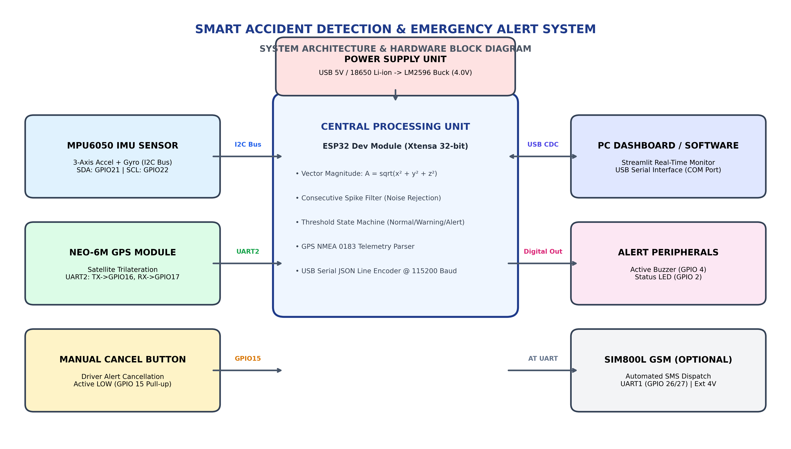

# Smart Accident Detection and Emergency Alert System

[](https://www.python.org/downloads/)
[](LICENSE)
[](https://streamlit.io/)
[](hardware/README.md)
[](software/tests/)

An engineering-grade vehicular safety and emergency dispatch telematics project designed with **dual software and hardware implementations**.

> [!IMPORTANT]
> **Zero Hardware Required to Run:** The software implementation includes an autonomous sensor and GPS simulation engine with a full-stack **Streamlit interactive web dashboard**. You can explore and test the complete system on any computer without needing physical hardware!  
> Physical hardware integration with an **ESP32**, **MPU6050**, and **NEO-6M GPS** is completely modular and optional.

---

## 📌 Quick Links

- 💻 [**Software Implementation Guide & Dashboard Manual**](software/README.md)
- 🔌 [**Hardware Schematics, Pinouts & Firmware Guide**](hardware/README.md)
- 📑 [**Academic Mini-Project Report (Markdown)**](docs/PROJECT_REPORT.md)
- 📐 [**System Architecture & State Machine**](docs/SYSTEM_ARCHITECTURE.md)
- 🚀 [**Future Enhancements Roadmap**](docs/FUTURE_ENHANCEMENTS.md)

---

## 1. Project Overview

Traffic collisions are sudden, violent events where seconds dictate survival. The **"Golden Hour"** in emergency medicine refers to the first 60 minutes after traumatic injury, where rapid surgical or medical intervention drastically increases survival rates. In many real-world crashes, victims are incapacitated or vehicle occupants are unable to reach a mobile phone.

The **Smart Accident Detection and Emergency Alert System** solves this critical problem by providing:
1. **Continuous 3-Axis Inertial Monitoring:** Measures longitudinal, lateral, and vertical accelerations ($X, Y, Z$) to identify high-G impacts regardless of collision angle or rollover.
2. **Intelligent Noise & Pothole Filtering:** Evaluates consecutive reading windows to prevent false emergency dispatches triggered by speed bumps or potholes.
3. **Automated GPS Positioning:** Acquires latitude and longitude coordinates and generates an instant **Google Maps tracking link**.
4. **Emergency Dispatch Simulation:** Automatically constructs and logs emergency SMS payloads ready for cellular or cloud transmission.
5. **Driver Cancellation Window:** Enables drivers to cancel false alarms via an in-cabin push button or software GUI before alerts are transmitted.

---

## 2. Problem Statement

Traditional automotive emergency reporting suffers from major flaws:
- **Exclusively Human-Initiated:** If vehicle occupants lose consciousness, notification to emergency responders is delayed until a third-party bystander spots the wreckage.
- **Vague Geographical Landmarks:** Distressed callers struggle to describe exact highway markers or rural coordinates, wasting valuable rescue time.
- **Nuisance False Triggers:** Primitive shock switches trigger alarms on ordinary rough roads, causing alarm fatigue.
- **Hardware Bottlenecks for Students & Learners:** Most embedded projects cannot be demonstrated without access to physical chips and sensors.

---

## 3. Key Objectives

- Develop a mathematical acceleration magnitude algorithm:
  $$A = \sqrt{x^2 + y^2 + z^2}$$
- Classify vehicle states across `NORMAL`, `WARNING`, `ACCIDENT_DETECTED`, and `CANCELLED`.
- Filter transient anomalies by requiring consecutive threshold violations.
- Provide a responsive web dashboard with live charts, metric cards, and map positioning.
- Enable seamless switching between **Simulation Mode** (software-only) and **Hardware Mode** (ESP32 via USB).
- Maintain rigorous engineering documentation for academic and practical evaluation.

---

## 4. Key Features

- **Dual-Mode Operation:**
  - **Simulation Mode (Default):** Synthesizes realistic vehicle cruising, minor turns, speed bumps, braking, and violent collision shocks.
  - **Hardware Mode:** Connects to an ESP32 microcontroller over USB serial, streaming live MPU6050 and NEO-6M telemetry.
- **Interactive Streamlit Dashboard:** Live acceleration gauges, interactive threshold sliders, real-time line charts, map displays, and emergency dispatch logs.
- **Configurable Sensitivity:** Dynamic threshold adjustment sliders for impact magnitude (default $28.0 \text{ m/s}^2$) and consecutive reading window.
- **Defensive Telemetry Parser:** Resilient JSON Lines parser that isolates corrupted frames without crashing.
- **One-Click Manual Alert Cancellation:** Aborts emergency sequences if the collision was minor or a false trigger.
- **Headless CLI Runner:** Standalone command-line testing mode for headless servers or automated scripts.

---

## 5. System Architecture

```
+-----------------------------------------------------------------------------------------+
|                                 SYSTEM ARCHITECTURE                                     |
|                                                                                         |
|   [ Physical MPU6050 IMU ]               [ Synthetic Sensor Simulator ]                 |
|   [ Physical NEO-6M GPS  ]               [ Synthetic GPS Simulator    ]                 |
|              |                                          |                               |
|              v (I2C / UART2)                            v (In-memory Python)            |
|   +-----------------------+              +-------------------------------+              |
|   |   ESP32 Microcontroller|              |      Python Detection Core    |              |
|   | - Magnitude Math Engine|              | - Vector Magnitude Engine     |              |
|   | - Consecutive Filter  |              | - Consecutive Spike Filter    |              |
|   | - Status State Machine|              | - Finite State Machine        |              |
|   +-----------+-----------+              +---------------+---------------+              |
|               |                                          |                              |
|               v (USB Serial JSON Lines)                  |                              |
|   +------------------------------------------------------+                              |
|   |                                                                                     |
|   v                                                                                     |
|   +---------------------------------------------------------------------------------+   |
|   |                     Streamlit Real-Time Web Dashboard                            |   |
|   |  - Real-time Metric Cards (X, Y, Z, Total Magnitude in m/s² and g)              |   |
|   |  - Live Waveform Graphs vs. Dynamic Threshold Line                              |   |
|   |  - Embedded Google Maps Coordinate Pinpoint                                     |   |
|   |  - Driver Emergency Cancel & System Reset Buttons                               |   |
|   |  - Emergency Dispatch SMS History Table                                         |   |
|   +---------------------------------------------------------------------------------+   |
+-----------------------------------------------------------------------------------------+
```



---

## 6. Mathematical Working Principle

Vehicles experience dynamic multidirectional forces during collisions. Relying on a single axis (e.g., only X or only Y) causes missed detections during diagonal collisions or rollovers.

The system calculates the Euclidean vector magnitude across all three spatial dimensions:

$$A_{\text{total}} = \sqrt{a_x^2 + a_y^2 + a_z^2}$$

### Calibrated Threshold States:
- **Normal Cruising:** $A_{\text{total}} \approx 9.81 \pm 2.0 \text{ m/s}^2$ ($a_z$ carries $1.0g$ Earth gravity).
- **Speed Bump / Road Pothole:** $A_{\text{total}} \in [14.0, 20.0] \text{ m/s}^2 \implies$ Triggers transient `WARNING` state. Auto-recovers to `NORMAL`.
- **Severe Collision Shock:** $A_{\text{total}} \ge 28.0 \text{ m/s}^2$ ($\ge 2.85g$). If sustained for $\ge 2$ consecutive readings, system locks into `ACCIDENT_DETECTED`.

For mathematical proofs, see [hardware/working_principle.md](hardware/working_principle.md).

---

## 7. Hardware & Software Integration

When an ESP32 is attached via USB, it transmits structured **JSON Lines (`JSONL`)** at **115200 baud** every 500 ms:

```json
{"x":0.20,"y":0.30,"z":9.81,"latitude":11.016800,"longitude":76.955800,"status":"NORMAL"}
```

The Python backend continuously reads, parses, and validates each line. If the physical hardware is unplugged or disconnected, the dashboard gracefully reports the disconnection and offers seamless fallback to **Simulation Mode**.

---

## 8. Components & Technologies Used

### Hardware Components (Optional for Physical Integration)
- **ESP32 Development Board** (ESP-WROOM-32 / NodeMCU-32S, 32-bit dual-core @ 240 MHz).
- **MPU6050** 6-Axis Inertial Measurement Unit (I2C interface).
- **u-blox NEO-6M** GPS Receiver with ceramic patch antenna (UART interface).
- **Active Piezo Buzzer** (GPIO 4) & Status LED (GPIO 2).
- **Momentary Push Button** (GPIO 15) for driver cancellation.
- **SIM800L GSM Module** (*Optional*: Requires external regulated 4.0V / 2A supply).

### Software Stack
- **Python 3.10+**
- **Streamlit** (Real-time web monitoring UI)
- **PySerial** (Hardware USB UART communication)
- **Pandas & NumPy** (Telemetry data processing)
- **Pytest** (Automated test suite)
- **Arduino IDE & C++** (ESP32 embedded firmware)

---

## 9. Complete Project Folder Structure

```
Smart-Accident-Detection-System/
├── README.md                      # Primary project overview and instructions
├── LICENSE                        # MIT Open-Source License
├── .gitignore                     # Git ignore rules for Python & embedded files
│
├── software/                      # Complete standalone Python software suite
│   ├── README.md                  # Software installation and user manual
│   ├── requirements.txt           # Python dependency requirements
│   ├── main.py                    # Multi-mode launcher (Dashboard & CLI)
│   ├── core/                      # Algorithmic engine
│   │   ├── accident_detection.py  # Magnitude math, filtering & state machine
│   │   ├── sensor_simulator.py    # Synthetic motion & impact generator
│   │   ├── gps_simulator.py       # Simulated GPS coordinates & Maps URLs
│   │   └── alert_manager.py       # Emergency dispatch & SMS payload generator
│   ├── hardware_interface/        # Serial hardware communication layer
│   │   ├── serial_communication.py# PySerial COM port manager & auto-discovery
│   │   └── sensor_data_parser.py  # Telemetry validator (JSONL & CSV)
│   ├── dashboard/                 # Web application interface
│   │   └── app.py                 # Streamlit real-time monitoring dashboard
│   ├── data/                      # Recorded vehicle telemetry datasets
│   │   └── sample_sensor_data.csv # Real-world driving & collision dataset
│   └── tests/                     # Automated unit testing suite
│       └── test_accident_detection.py # 16 comprehensive unit tests
│
├── hardware/                      # Physical embedded hardware design
│   ├── README.md                  # Hardware setup, pinouts & wiring guide
│   ├── components_list.md         # Detailed component specifications
│   ├── circuit_diagram.md         # Pin-by-pin interconnection reference
│   ├── working_principle.md       # Physics, MEMS and trilateration theory
│   ├── esp32/
│   │   └── accident_detection_esp32.ino # Complete ESP32 Arduino firmware
│   ├── diagrams/
│   │   ├── block_diagram.png      # High-resolution system block diagram
│   │   └── circuit_diagram.png    # High-resolution schematic wiring diagram
│   └── documentation/
│       └── hardware_setup.md      # Flashing and assembly walkthrough
│
├── docs/                          # Comprehensive project documentation
│   ├── PROJECT_REPORT.md          # Full academic ECE mini-project report
│   ├── SYSTEM_ARCHITECTURE.md     # Deep architecture, sequence & state models
│   └── FUTURE_ENHANCEMENTS.md     # TinyML, CAN-bus & 4G eCall roadmap
│
└── images/
    └── screenshots/               # Dashboard screenshots & hardware photos
```

---

## 10. Installation & Quick Start

### Step 1: Clone or Navigate to Project
```bash
cd "d:/akshaya/1st project"
```

### Step 2: Install Python Dependencies
```bash
pip install -r software/requirements.txt
```

### Step 3: Run the Application

#### Option 1: Launch Interactive Streamlit Dashboard (Recommended)
```bash
python software/main.py
```
*Or directly via Streamlit:*
```bash
streamlit run software/dashboard/app.py
```
The browser will automatically open to `http://localhost:8501`.

#### Option 2: Run Headless CLI Simulation
```bash
python software/main.py --cli --duration 20
```

#### Option 3: Run Unit Test Suite
```bash
python -m pytest software/tests/test_accident_detection.py -v
```

---

## 11. Connecting Real ESP32 Hardware

1. Follow the wiring instructions in [`hardware/circuit_diagram.md`](hardware/circuit_diagram.md).
2. Open [`hardware/esp32/accident_detection_esp32.ino`](hardware/esp32/accident_detection_esp32.ino) in Arduino IDE and flash to your ESP32.
3. Plug the ESP32 into your computer via micro-USB.
4. Launch the Streamlit dashboard (`python software/main.py`).
5. In the sidebar, switch to **"Hardware Mode (ESP32)"**, select your COM port, and click **"Connect ESP32"**.

> [!CAUTION]
> **Power Supply Reminder for SIM800L GSM:** If connecting the optional SIM800L module, **do not power it from the ESP32 3.3V pin**. Use an external 4.0V DC-DC buck converter (LM2596) or 18650 Li-ion battery sharing a common ground with the ESP32.

---

## 12. Applications

- **Automotive Safety Telematics:** Retractable black-box crash recorder and automated emergency caller for commercial and personal vehicles.
- **Two-Wheeler / Motorcycle Fall Detection:** Immediate emergency alerting for solo riders involved in high-speed skids or falls on isolated roads.
- **Fleet Management & Logistics:** Real-time impact monitoring for shipping trucks carrying fragile cargo.
- **Academic Learning & Research:** Practical laboratory project for students studying embedded systems, sensor fusion, and IoT development.

---

## 13. Limitations & Disclaimers

- **Academic Prototype:** This project is developed as an educational ECE mini-project and has **not been certified for legal, medical, or ISO 26262 automotive safety use**.
- **Cellular & GPS Coverage:** In deep underground tunnels or dense urban canyons, satellite and cellular reception may experience temporary attenuation.
- **Vehicle Rigidity Variations:** Sensor thresholds should be fine-tuned based on the mounting location (rigid chassis vs. plastic dashboard).

---

## 14. License & Author

- **License:** Distributed under the open-source [MIT License](LICENSE).
- **Author:** Smart Accident Detection System Project Team (ECE Department).
# Smart-Accident-Detection-System

