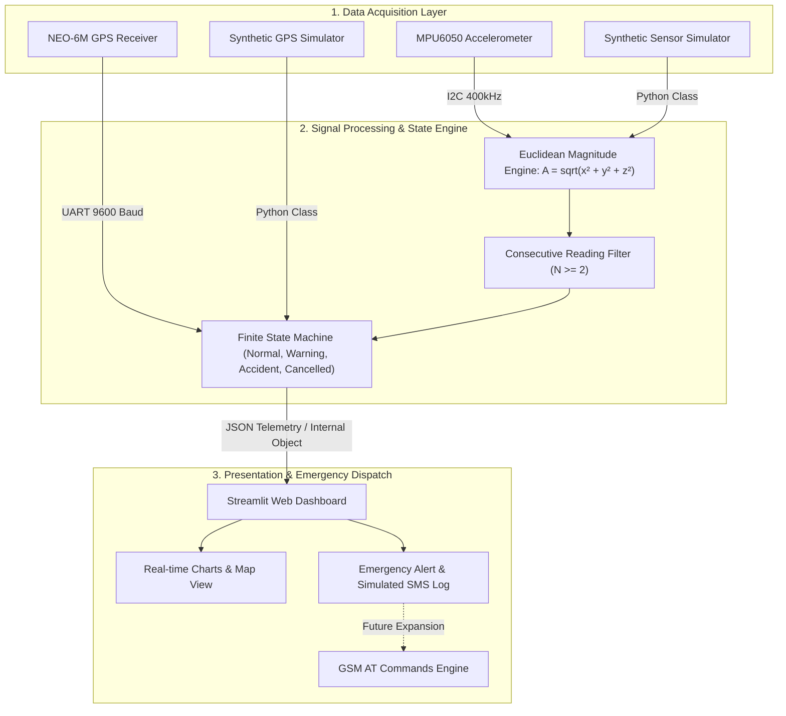
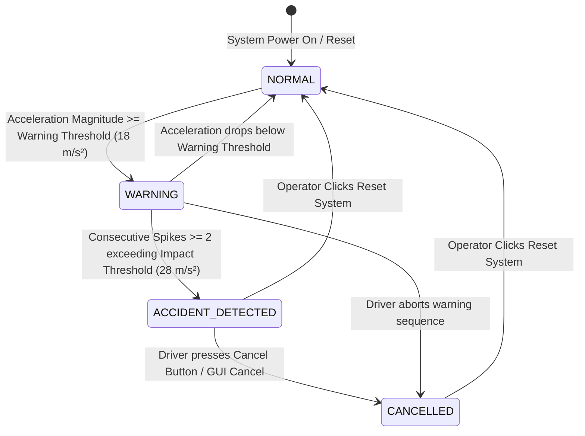
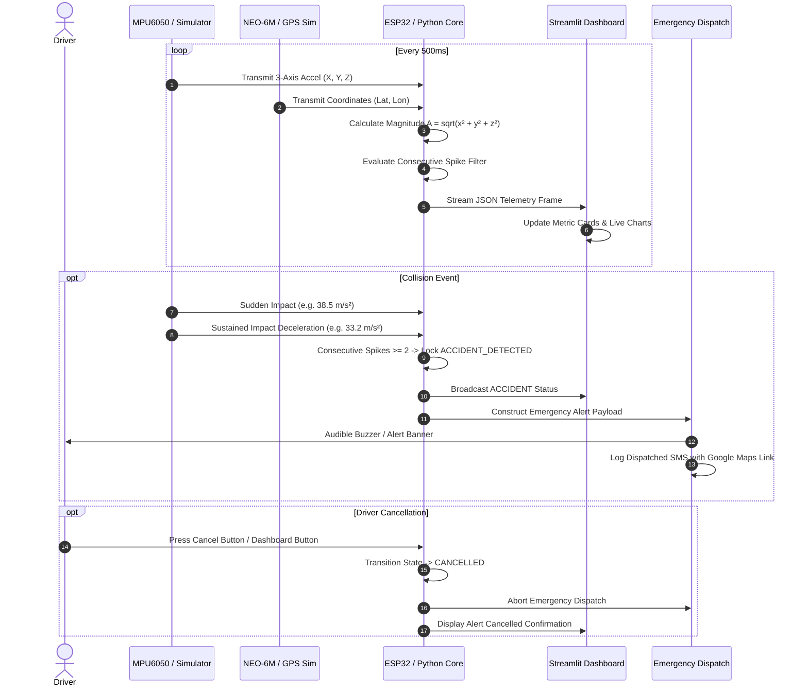

# System Architecture & Technical Specification

This document provides an in-depth architectural breakdown of the **Smart Accident Detection and Emergency Alert System**.

---

## 1. High-Level Architectural Decomposition

The system is architected into three decoupled layers:
1. **Sensor & Acquisition Layer (Hardware / Synthetic Simulation):** Generates 3-axis acceleration and geographic positioning.
2. **Signal Processing & Decision Layer (Embedded Firmware / Python Core):** Computes Euclidean vector magnitudes, filters transient mechanical anomalies, and executes the finite state machine.
3. **Presentation & Telemetry Layer (Streamlit Dashboard & Alert Manager):** Visualizes live telemetry, handles serial handshakes, manages emergency dispatches, and provides driver controls.

---

## 2. Finite State Machine (FSM)

The system moves across four well-defined states:

### State Definitions:
- **`NORMAL`:** Accelerations remain within standard vehicular cruising parameters ($A \approx 9.81 \pm 2.0 \text{ m/s}^2$).
- **`WARNING`:** An abnormal jolt or severe deceleration is detected ($A \ge 18.0 \text{ m/s}^2$). Buzzer remains silent while consecutive readings determine whether it is a harmless speed bump or an active crash.
- **`ACCIDENT_DETECTED`:** High-G collision confirmed across multiple consecutive sample frames ($A \ge 28.0 \text{ m/s}^2$). Buzzer sounds continuously, rapid LED flashing engages, and emergency SMS dispatch payload is broadcast with Google Maps tracking coordinates.
- **`CANCELLED`:** The driver or occupant manually overrides the alert sequence within the cancellation window. Emergency dispatches are aborted.

---

## 3. Telemetry Sequence Diagram

---

## 4. Failure Modes and Mitigation Strategies

| Potential Failure Mode | Root Cause | Built-in Architectural Mitigation |
| :--- | :--- | :--- |
| **Speed bump / Pothole False Alarm** | Momentary vertical mechanical shock | Consecutive reading filter requires $N \ge 2$ consecutive spikes above $28 \text{ m/s}^2$ before triggering accident state. |
| **I2C Bus Lockup** | Electrical noise on SDA/SCL lines | Defensive read routines catch bus errors and provide safe default values ($a_z = 9.81$) without firmware freeze. |
| **GPS Fix Loss (Tunnels / Indoors)** | Satellite signal attenuation | Software retains and transmits last known valid coordinates with a fix warning flag. |
| **Serial Communication Disconnect** | USB cable unseated during drive | Python manager traps `SerialException`, automatically unmounts port, and warns the user without crashing. |
| **Simulated vs Hardware Ambiguity** | Unclear origin of displayed telemetry | Prominent UI badges clearly identify whether data originates from physical ESP32 or simulation engine. |
