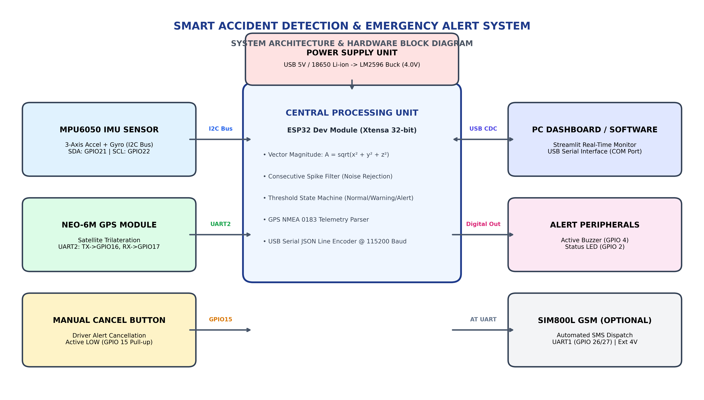
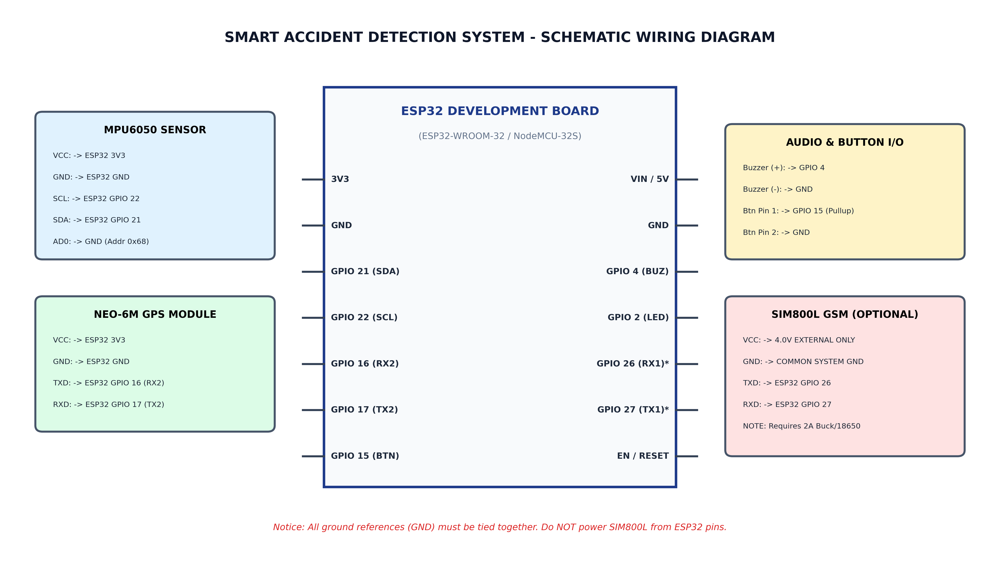

# Hardware Implementation - Smart Accident Detection System

This directory contains the complete embedded hardware design, circuit schematics, wiring documentation, and Arduino firmware for the **Smart Accident Detection and Emergency Alert System**.

> [!NOTE]
> The software portion of this project can operate **completely independently in Simulation Mode**. Building or purchasing the physical hardware described here is **optional** and intended for laboratory demonstrations, physical breadboard prototyping, and future vehicular deployment.

---

## 1. Hardware Overview

The hardware system continuously captures physical vehicle dynamics using an **ESP32 microcontroller** paired with an **MPU6050 6-DOF IMU** and **NEO-6M GPS receiver**. When an abnormal deceleration or high-G collision is detected, the on-board firmware triggers an acoustic warning buzzer and transmits real-time telemetry over USB serial to the host computer running the Python monitoring dashboard.

```
+--------------------------------------------------------------------------------+
|                             HARDWARE FLOW                                      |
|                                                                                |
|  [MPU6050 Accelerometer] --(I2C)--> [   ESP32 Microcontroller   ]             |
|  [NEO-6M GPS Receiver]  --(UART2)-> [ - Vector Magnitude Math   ]             |
|  [Manual Cancel Button] --(GPIO)--> [ - Consecutive Filter      ]             |
|                                     [ - Status State Machine    ]             |
|                                              |                                 |
|                               +--------------+---------------+                 |
|                               |                              |                 |
|                     (USB Serial JSONL)                 (GPIO Out)              |
|                               v                              v                 |
|                      [Python Dashboard]              [Piezo Buzzer & LED]      |
+--------------------------------------------------------------------------------+
```

---

## 2. System Architecture & Block Diagram



For architectural details, see [working_principle.md](file:///d:/akshaya/1st%20project/hardware/working_principle.md).

---

## 3. Circuit Schematic & Wiring Guide



### Pin Connection Summary Table

| Peripheral | Module Pin | ESP32 Pin | Interface / Bus | Voltage & Current Notes |
| :--- | :--- | :--- | :--- | :--- |
| **MPU6050 IMU** | `VCC` | `3.3V` | Power | Connect to clean 3.3V rail |
| | `GND` | `GND` | Ground | Common system ground |
| | `SCL` | `GPIO 22` | I2C Clock | Pull-up onboard module |
| | `SDA` | `GPIO 21` | I2C Data | Bi-directional serial data |
| | `AD0` | `GND` | Address Select | Sets I2C address to `0x68` |
| **NEO-6M GPS** | `VCC` | `3.3V` or `5V` | Power | Built-in LDO accommodates 3.3V/5V |
| | `GND` | `GND` | Ground | Common system ground |
| | `TX` | `GPIO 16` (RX2)| UART RX | Receives NMEA 0183 sentences |
| | `RX` | `GPIO 17` (TX2)| UART TX | Optional configuration line |
| **Active Buzzer** | `(+)` | `GPIO 4` | Digital Output | High during accident alert |
| | `(-)` | `GND` | Ground | Common ground |
| **Cancel Button** | `Pin 1` | `GPIO 15` | Digital Input | Internal `INPUT_PULLUP` enabled |
| | `Pin 2` | `GND` | Ground | Pulls LOW when pressed |
| **SIM800L (Opt)** | `VCC` | **External 4.0V** | High Current | **DO NOT connect to ESP32 3.3V!** |
| | `GND` | **External GND** | Ground | **Must tie to ESP32 GND** |
| | `TXD` | `GPIO 26` | UART RX | ESP32 receives AT responses |
| | `RXD` | `GPIO 27` | UART TX | ESP32 sends AT commands |

For detailed connection diagrams, see [circuit_diagram.md](file:///d:/akshaya/1st%20project/hardware/circuit_diagram.md) and [components_list.md](file:///d:/akshaya/1st%20project/hardware/components_list.md).

---

## 4. Critical Power Supply Guidelines

> [!CAUTION]
> **DO NOT POWER THE SIM800L MODULE DIRECTLY FROM THE ESP32 PINS!**
> The SIM800L GSM transceiver requires an operating voltage between **3.7V and 4.2V** and draws **burst transmission pulses of up to 2.0 Amperes**. The ESP32 onboard regulator is only rated for ~500–800mA. Attempting to power SIM800L from ESP32 will trigger constant brownout resets or permanently damage the regulator.
>
> **Recommended Power Solution:**
> - Use an external **LM2596 DC-DC step-down buck converter** adjusted to **4.0V**, or a high-discharge **18650 3.7V Li-ion battery**.
> - Solder a **1000 µF 16V low-ESR capacitor** directly across SIM800L `VCC` and `GND`.
> - Always connect the **External Power Supply Ground** to the **ESP32 Ground** to maintain a common ground reference.

---

## 5. Arduino IDE Setup & Code Upload

1. Install [Arduino IDE 2.x](https://www.arduino.cc/en/software).
2. Add the ESP32 board manager URL in **File > Preferences**:
   ```
   https://raw.githubusercontent.com/espressif/arduino-esp32/gh-pages/package_esp32_index.json
   ```
3. Install the **esp32** board platform from **Tools > Board > Boards Manager**.
4. Install the following libraries via **Tools > Manage Libraries...**:
   - `Adafruit MPU6050`
   - `Adafruit Unified Sensor`
   - `Adafruit BusIO`
   - `TinyGPSPlus`
5. Open [`hardware/esp32/accident_detection_esp32.ino`](file:///d:/akshaya/1st%20project/hardware/esp32/accident_detection_esp32.ino).
6. Connect the ESP32 to your computer using a micro-USB data cable.
7. Select **Tools > Board > ESP32 Dev Module** and choose your COM port.
8. Click **Upload**. (If the console shows `Connecting...`, press and hold the **BOOT** button on the ESP32 board).

For complete step-by-step instructions, see [hardware_setup.md](file:///d:/akshaya/1st%20project/hardware/documentation/hardware_setup.md).

---

## 6. Serial Telemetry Protocol (ESP32 to Python)

The ESP32 broadcasts a JSON Line telemetry packet over USB Serial at **115200 baud** every 500 ms:

```json
{"x":0.20,"y":0.30,"z":9.81,"latitude":11.016800,"longitude":76.955800,"status":"NORMAL"}
```

### Telemetry Field Definitions:
- `x`: Acceleration along X-axis in $\text{m/s}^2$ (lateral).
- `y`: Acceleration along Y-axis in $\text{m/s}^2$ (longitudinal).
- `z`: Acceleration along Z-axis in $\text{m/s}^2$ (vertical earth gravity $\approx 9.81$).
- `latitude`: GPS latitude in decimal degrees.
- `longitude`: GPS longitude in decimal degrees.
- `status`: String state (`NORMAL`, `WARNING`, `ACCIDENT_DETECTED`, `CANCELLED`).

---

## 7. Troubleshooting

- **MPU6050 not responding (Error 2 or 4):** Verify that the `AD0` pin is grounded and `SDA`/`SCL` lines are wired to GPIO 21 and 22.
- **GPS Coordinates remain at default:** GPS receivers require an unobstructed view of the open sky. Place the antenna near an open window or outdoors and allow 2 to 5 minutes to acquire initial satellite lock.
- **Python shows "Hardware Disconnected":** Close the Arduino Serial Monitor before starting the Python dashboard. A COM port can only be accessed by one application at a time.

---

## 8. Future Hardware Improvements

1. **CAN-Bus OBD-II Interface:** Read vehicle speed, airbag deployment status, and braking pressure directly from the vehicle ECU.
2. **4G LTE / NB-IoT Upgrade:** Replace 2G SIM800L with an LTE module (SIM7600 or A7670C) to support modern 4G/5G mobile networks.
3. **Internal LiPo Battery Backup:** Implement an uninterruptible power supply (UPS) circuit so the device continues operating if the vehicle battery is severed during a crash.
