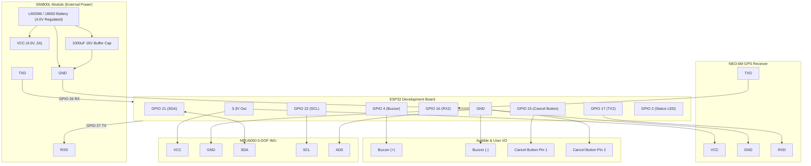

# Circuit Diagram & Interconnection Guide

This document describes the complete wiring topology, pin connections, logic-level matching, and schematic layout for connecting physical sensors to the ESP32 microcontroller.

---

## 1. Complete Pin Connection Mapping Table

| Periph / Module | Module Pin | ESP32 Pin | Interface Type | Electrical Notes |
| :--- | :--- | :--- | :--- | :--- |
| **MPU6050** | VCC | 3.3V | Power | Powers IMU regulator (Clean 3.3V) |
| | GND | GND | Ground | Common system ground |
| | SCL | GPIO 22 | I2C Clock | Pull-up internal or on module |
| | SDA | GPIO 21 | I2C Data | Bi-directional I2C bus |
| | AD0 | GND | Address Select | Selects default I2C address `0x68` |
| | INT | Not Connected | Interrupt | Polled via software timer |
| **NEO-6M GPS** | VCC | 3.3V or 5V (VIN)| Power | Module onboard LDO regulates to 3.3V |
| | GND | GND | Ground | Common system ground |
| | TX | GPIO 16 (RX2) | UART RX | ESP32 HardwareSerial 2 RX |
| | RX | GPIO 17 (TX2) | UART TX | Optional for sending NMEA commands |
| **Active Buzzer** | (+) Anode | GPIO 4 | Digital Output | Driven HIGH during accident alert |
| | (-) Cathode | GND | Ground | Common system ground |
| **Push Button** | Terminal 1 | GPIO 15 | Digital Input | Configured with `INPUT_PULLUP` |
| | Terminal 2 | GND | Ground | Pulls GPIO 15 LOW when pressed |
| **Status LED** | Anode (+) | GPIO 2 | Digital Output | In series with 220Ω resistor |
| | Cathode (-) | GND | Ground | Common system ground |
| **SIM800L (Opt)**| VCC | **External 4.0V** | High Current | **DO NOT CONNECT TO ESP32 3.3V!** |
| | GND | **External GND** | Ground | **Must share common ground with ESP32**|
| | SIM_TXD | GPIO 26 (RX1) | UART RX | 3.3V compatible output from GSM |
| | SIM_RXD | GPIO 27 (TX1) | UART TX | 3.3V logic to SIM800L RX |

---

## 2. Mermaid Circuit Topology Diagram



---

## 3. ASCII Circuit Diagram

```
                 +---------------------------------------+
                 |            ESP32 Microcontroller      |
                 |                                       |
                 |  [3.3V]  [GND]   [21]   [22]   [16]   |
                 +----+-------+-------+------+------+----+
                      |       |       |      |      |
         +------------+       |       |      |      |
         |                    |       |      |      |
   +-----+-----+              |       |      |      |
   |  MPU6050  |              |       |      |      |
   |  VCC  GND |<-------------+       |      |      |
   |  SDA  SCL |<---------------------+------+      |
   |  AD0 (GND)|                      |             |
   +-----------+                      |             |
                                      |             |
   +-----------+                      |             |
   |  NEO-6M   |                      |             |
   |  VCC  GND |<---------------------+             |
   |  TXD      |------------------------------------+
   +-----------+
                                      |
   +-----------+                      |
   |  BUZZER   |                      |
   |  (+)  (-) |<---------------------+
   |   ^       |
   +---|-------+
       |
     GPIO 4

   +-----------+
   |  BUTTON   |
   |  (Cancel) |
   |   1     2 |<---------------------+
   +---|-------+
       |
     GPIO 15 (Pullup)
```

---

## 4. Hardware Wiring Best Practices
1. **Twisted Pairs for I2C:** Keep wires between MPU6050 and ESP32 under 20 cm in length to prevent inductive noise or data corruption.
2. **GPS Antenna Placement:** The ceramic patch on the NEO-6M GPS antenna must face unobstructed toward the sky or open window. Indoors, satellite lock may take 2–5 minutes.
3. **Common Ground Reference:** When using external power supplies for GSM or high-power buzzers, always tie all ground (`GND`) pins together.
